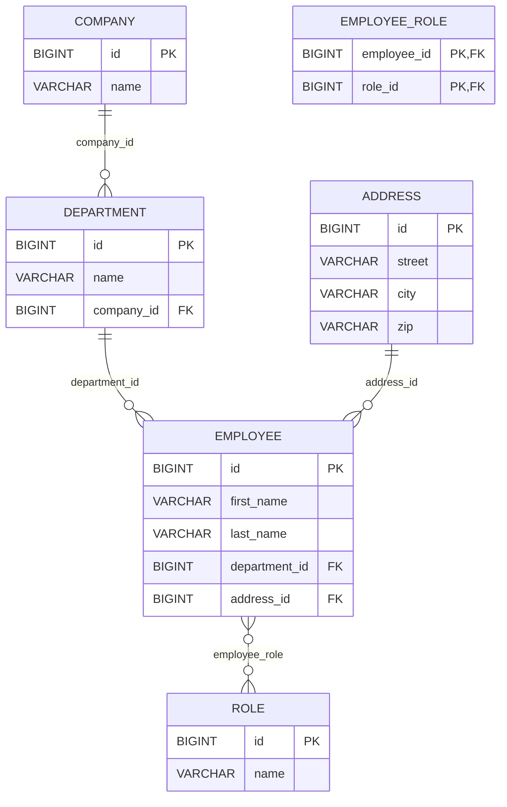

# Maxmilian Lamm Portfolio

This project was generated using [Angular CLI](https://github.com/angular/angular-cli) version 20.0.4.

## Database Schema



## Development server

To start a local development server, run:

```bash
ng serve
```
